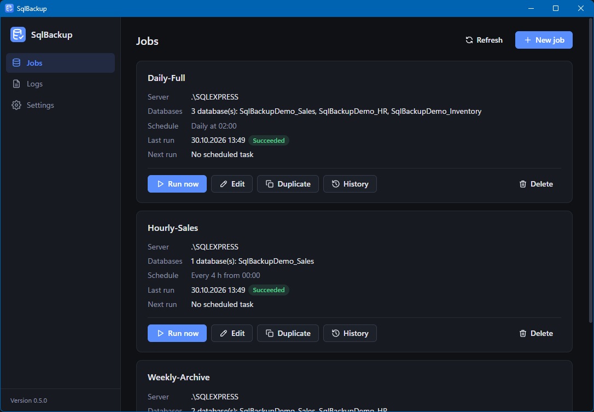
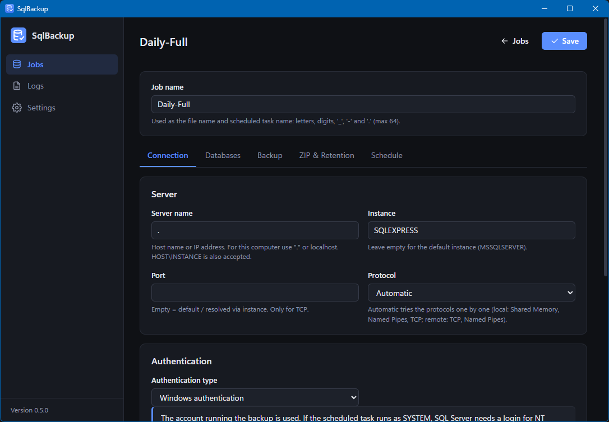
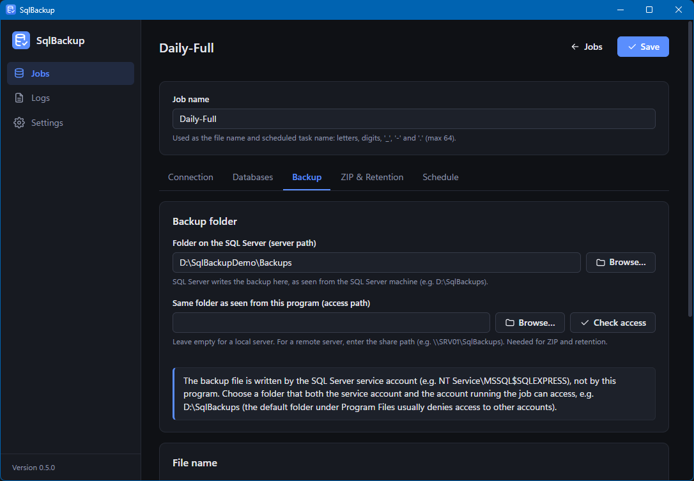
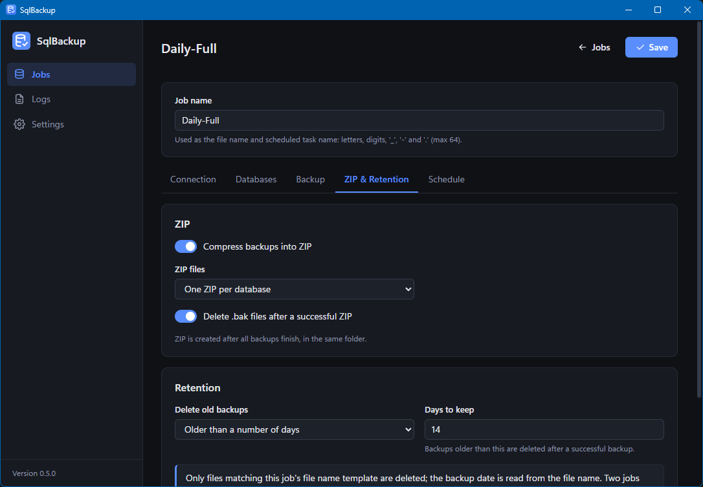
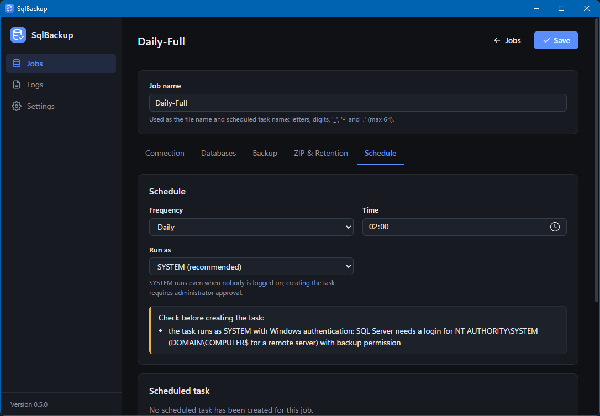
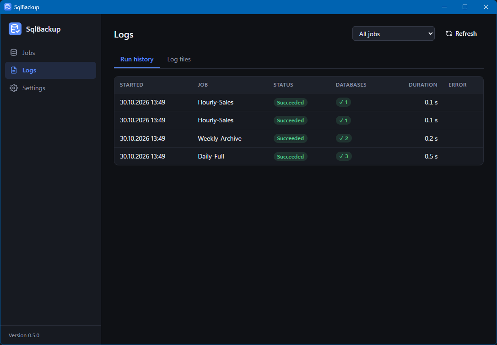
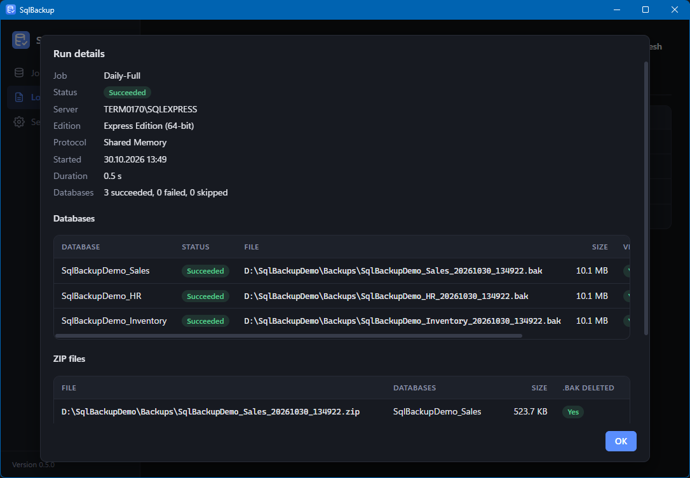
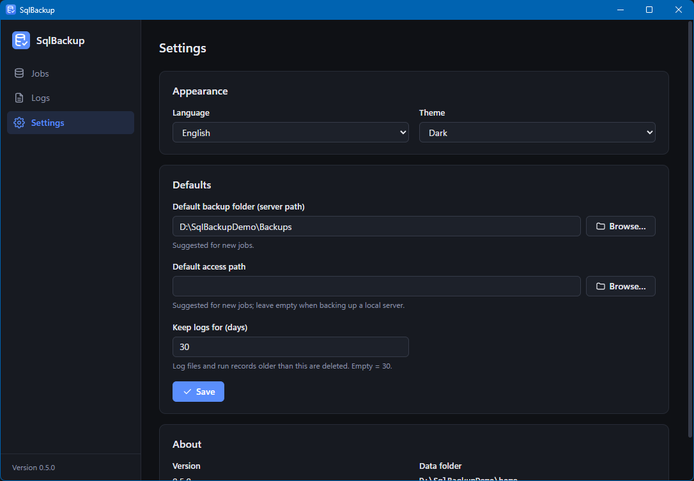

# SqlBackup

**English** | [Türkçe](README.tr.md)

Automatic Microsoft SQL Server backup for Windows. Takes **FULL** backups of one or more databases, optionally verifies them, zips them and deletes old backups. Jobs are set up in the GUI and scheduled with Windows Task Scheduler.

- Single exe: without arguments it opens the GUI, with arguments it runs as a command-line tool (used by the scheduled task).
- Local and remote SQL Server; Windows or SQL authentication.
- UI languages: English, Turkish, German, Spanish, French, Italian, Portuguese. If no language is chosen in Settings, the one matching the Windows display language is used, otherwise English.
- Out of scope: differential / transaction log backups, e-mail notifications.



## Screenshots

| | |
|---|---|
| [](docs/screenshots/en/editor-connection.png)<br>**Connection:** server, instance, protocol, authentication | [](docs/screenshots/en/editor-backup.png)<br>**Backup:** server path and access path, file name template |
| [](docs/screenshots/en/editor-zip.png)<br>**ZIP & Retention:** one ZIP per database, deleting old backups | [](docs/screenshots/en/editor-schedule.png)<br>**Schedule:** daily / weekly / hourly, SYSTEM or current user |
| [](docs/screenshots/en/logs.png)<br>**Logs:** run history and log files | [](docs/screenshots/en/run-detail.png)<br>**Run details:** databases, files, ZIPs |
| [](docs/screenshots/en/settings.png)<br>**Settings:** language, theme, default folders | |

## Download

No need to build; download the latest release:

| File | When |
|---|---|
| [**SqlBackup-windows-amd64-setup.exe**](https://github.com/OWNER/SqlBackup/releases/latest/download/SqlBackup-windows-amd64-setup.exe) | **Recommended.** Installs to `Program Files`; required for running the scheduled task as SYSTEM. |
| [SqlBackup-windows-amd64.zip](https://github.com/OWNER/SqlBackup/releases/latest/download/SqlBackup-windows-amd64.zip) | Portable; for trying it without installing, or running the task under your own Windows account. |
| [SHA256SUMS.txt](https://github.com/OWNER/SqlBackup/releases/latest/download/SHA256SUMS.txt) | For verifying the downloaded file. |

Older versions and release notes: [Releases](https://github.com/OWNER/SqlBackup/releases).

- The program is not code-signed; Windows SmartScreen may say "Windows protected your PC" on first launch. Continue with **More info → Run anyway**.
- To verify a download, compare the value printed by PowerShell with `SHA256SUMS.txt`:
  ```powershell
  (Get-FileHash .\SqlBackup-windows-amd64-setup.exe -Algorithm SHA256).Hash
  ```

## Requirements

- Windows 10 / 11 or Windows Server 2016+ (64-bit)
- Microsoft Edge WebView2 Runtime (preinstalled on Windows 11; the installer adds it if needed)
- SQL Server 2012 or later (tested with SQL Server Express). Express and Web editions do not support backup compression; in that case compression is turned off and a warning is logged.

## Installation

**Installer:** `SqlBackup-windows-amd64-setup.exe` installs the program to `C:\Program Files\SqlBackup` and adds Start menu and desktop shortcuts.

**Portable:** extract the zip to a folder; `SqlBackup.exe` and the `lang\` folder next to it must stay together (without `lang\` the program runs in English only). If you extract the zip into a user folder (Desktop, Downloads), a SYSTEM task cannot be created (see [Scheduled task](#scheduled-task)); use the installer for that.

The program keeps its jobs, settings and logs in `%ProgramData%\SqlBackup` (the user profile is not used because the scheduled task may run as SYSTEM):

```
%ProgramData%\SqlBackup\
  settings.json             language, theme, log retention, default folders
  jobs\<job>.json           job definition (password only in encrypted form)
  jobs\<job>.bat            optional batch file
  logs\<job>_<date>.log     daily log
  logs\runs\*.json          result record of each run
```

Only SYSTEM, administrators and the Windows account using the program can access the folder (the encrypted SQL password in the job files can be decrypted on this computer, so the folder is closed to other users). Permissions of a folder created by an earlier version are fixed this way on the first start. If you also use the program from another Windows account, run it as administrator or grant that account access to the folder.

Uninstalling does **not** remove this folder or the scheduled tasks. To remove the program completely, first delete the tasks in the GUI (or with `SqlBackup.exe task delete --job <job>`), then delete the folder by hand.

## Usage

1. **Jobs → New job.** Give the job a name (letters, digits, `_ - .`; it is used as the file and task name).
2. **Connection:** server (`.`, `localhost`, `SERVER\INSTANCE`, IP), authentication and, if needed, protocol. *Test connection* shows the server version and the protocol used. With the automatic protocol, protocols are tried one by one (local: Shared Memory, Named Pipes, TCP; remote: TCP, Named Pipes); the SQL Browser service is not needed.
3. **Databases:** tick the ones to back up. With *Include new databases*, all databases on the server (except the unticked ones) are backed up at run time.
4. **Backup:** backup folder, file name template, compression / checksum / verify / copy-only.
5. **ZIP & Retention:** optional ZIP (one per database or a single file, delete `.bak`) and retention (days or count).
6. **Schedule:** daily / weekly / hourly; *Create task* creates the `\SqlBackup\<job>` task.
7. Try it with **Run now**; results are on the **Logs** page.

### Backup folder: server path and access path

The backup file is written by the **SQL Server service account**, not by this program. That is why there are two paths:

| Field | Meaning | Example |
|---|---|---|
| Server path | The folder as seen by SQL Server (`BACKUP ... TO DISK`) | `D:\SqlBackups` |
| Access path | The path this program uses to reach the same folder; needed for ZIP and retention. Leave empty for a local server. | `\\SQLSRV01\SqlBackups` |

- **Local server:** only the service account can write to default folders such as `C:\Program Files\Microsoft SQL Server\...\Backup`; the program cannot zip or apply retention there. Create a folder such as `D:\SqlBackups` and give Modify permission both to the service account (`NT Service\MSSQLSERVER` or `NT Service\MSSQL$<INSTANCE>`) and to the account that runs the task:
  ```
  icacls D:\SqlBackups /grant "NT Service\MSSQL$SQLEXPRESS:(OI)(CI)M"
  ```
- **Remote server:** the server path is a local path on the remote machine (`D:\SqlBackups`), not a path on this computer. If you want ZIP or retention, share the folder and enter its UNC path as the access path. If the task runs as SYSTEM, the share is accessed with this computer's machine account (`DOMAIN\COMPUTER$`); set share and NTFS permissions accordingly.
- If the error message contains "Operating system error 5", the service account cannot write to the folder; "error 3" means the folder was not found on the server machine.

### File name template

`{db}` is required. `{server}`, `{job}` and date parts such as `{yyyyMMdd}`, `{HHmmss}`, `{yyyy-MM-dd}` can also be used. `.bak` is appended if missing; names that collide in the same run get `_2`, `_3`. Retention finds old files by this template and the date in the file name; if you change the template, files with the old names are no longer deleted. Two jobs backing up the same database into the same folder with the same template count each other's files.

## Scheduled task

- Tasks are created in Task Scheduler under `\SqlBackup\<job>` and run `SqlBackup.exe run --job "<job.json>"` directly. Neither the task nor the `.bat` contains a password.
- **SYSTEM:** runs even when nobody is logged on; creating/updating the task requires administrator approval (UAC). The program must be in a folder that only administrators can modify (`Program Files` with the installer); otherwise the task is not created, because anyone who can replace the exe could run their own code as SYSTEM. **Current user:** runs only while that user is logged on, no administrator approval needed.
- If you move the program to another folder, recreate the tasks (the GUI marks outdated tasks).
- The task's "Last Run Result" is the program's exit code (see below).

## SQL Server permissions

For the connecting account (with Windows authentication, **the account running the job**; for a SYSTEM task `NT AUTHORITY\SYSTEM`, on a remote server `DOMAIN\COMPUTER$`):

| Needed | Why |
|---|---|
| Login on the server | Connection. For SQL authentication the server must be in "SQL Server and Windows Authentication" mode. |
| `db_backupoperator` (or `sysadmin`) in each database | `BACKUP DATABASE` |
| Read access to `backupset` / `backupmediafamily` in `msdb` | Backup size. Without it the backup is taken but the size is not shown (warning). |
| `CREATE DATABASE` permission (e.g. the `dbcreator` role) | `RESTORE VERIFYONLY`; only if *Verify* is on. |

Example (SYSTEM task, local server):

```sql
CREATE LOGIN [NT AUTHORITY\SYSTEM] FROM WINDOWS;  -- if missing
USE [MyDatabase];
CREATE USER [NT AUTHORITY\SYSTEM] FOR LOGIN [NT AUTHORITY\SYSTEM];
ALTER ROLE db_backupoperator ADD MEMBER [NT AUTHORITY\SYSTEM];
```

`tempdb`, OFFLINE databases and database snapshots cannot be backed up: if selected explicitly they are reported as errors, if they came in through *Include new databases* they are reported as skipped.

## Password security

The SQL password is encrypted with Windows DPAPI for **this computer** and stored only in the job file (`passwordEnc`); it is never written to logs, the `.bat`, the task or error messages. If the job file is copied to another computer the password cannot be decrypted; the GUI asks for it again. If you use SQL authentication with a remote server, turn on **Encrypt connection** with certificate validation ("Trust server certificate" off); otherwise the password is exposed to anyone intercepting the network, and the program warns when saving.

## Command line

```
SqlBackup.exe run   --job <job> [-v]       runs the job (backup, verify, zip, retention)
SqlBackup.exe test  --job <job>            tests the connection and backup folder access
SqlBackup.exe list  --job <job> [--json]   lists the databases on the server
SqlBackup.exe batch --job <job> [--path <file.bat>]
SqlBackup.exe task create|delete|run|status --job <job> [--elevate] [--json]
SqlBackup.exe version | help
```

`<job>`: a job name (in `%ProgramData%\SqlBackup\jobs`) or the path of a `.json` file. Global options: `--lang <code>`, `--home <data folder>`, `--output <file>`.

The exe is a windowed (GUI) application, so its output appears in the console only when redirected:

```
cmd /c "SqlBackup.exe list --job Daily 2>&1"
SqlBackup.exe run --job Daily --output C:\Temp\result.txt
```

**Exit codes:** `0` all succeeded · `1` partial failure (some databases, ZIP or retention failed; `task status`: no task) · `2` complete failure or settings/connection error · `3` job already running (not started).

## Languages

Language files are in the `lang\` folder next to the exe (`en.lng` is also embedded in the exe). To add a new language see [lang/README.md](lang/README.md).

## Development

Requires Go 1.27+, Node.js and the Wails v2 CLI (`go install github.com/wailsapp/wails/v2/cmd/wails@v2.17.0`).

```powershell
.\build.ps1                  # clean versioned build → build\bin\SqlBackup.exe + lang\
.\build.ps1 -Nsis            # + installer (NSIS must be installed)
.\build.ps1 -Release         # + dist\: setup.exe, portable zip, SHA256SUMS.txt
& "$(go env GOPATH)\bin\wails.exe" dev

go vet ./... ; go test ./internal/...
$env:SQLBACKUP_TEST_SERVER = '.\SQLEXPRESS'; go test ./internal/...   # SQL Server integration tests
$env:SQLBACKUP_TEST_TASKS = '1'; go test ./internal/scheduler/       # Task Scheduler integration tests
```

The single source of the version number is `wails.json` → `info.productVersion`.

### Publishing a release

Built files are not committed (`dist/` is ignored); they are uploaded to GitHub Releases. File names carry no version, so the `releases/latest/download/...` links above always point to the latest release.

1. Bump `wails.json` → `info.productVersion` and commit.
2. Run `.\build.ps1 -Release` on a clean working tree (it warns about uncommitted changes).
3. Tag and publish (with [GitHub CLI](https://cli.github.com/); the tag must match the version):
   ```powershell
   git tag v0.5.0; git push origin v0.5.0
   gh release create v0.5.0 dist\* --title "SqlBackup 0.5.0" --generate-notes
   ```
   Without `gh`, use **Releases → Draft a new release** on GitHub, pick the same tag and upload the three files in `dist\`.

## License

[MIT](LICENSE)
